# 手把手教你安装 VMware Workstation Pro

### ✨前言

无论是软件开发、测试新系统，还是想体验 Linux 环境又不想重装电脑，虚拟机都是我们的得力助手。而 VMware Workstation Pro 作为全球最受欢迎的虚拟机软件之一，凭借其强大的性能和丰富的功能，成为了许多开发者和技术爱好者的首选。
本文将带你一步步完成 VMware Workstation Pro 的下载与安装过程，即使是小白也能轻松上手。

### 🦀注：VMware 被博通收购后，下载流程有所变化，现在个人使用通常是免费的，但需要注册博通账户。

## 第一步：注册

```
https://profile.broadcom.com/web/registration
```

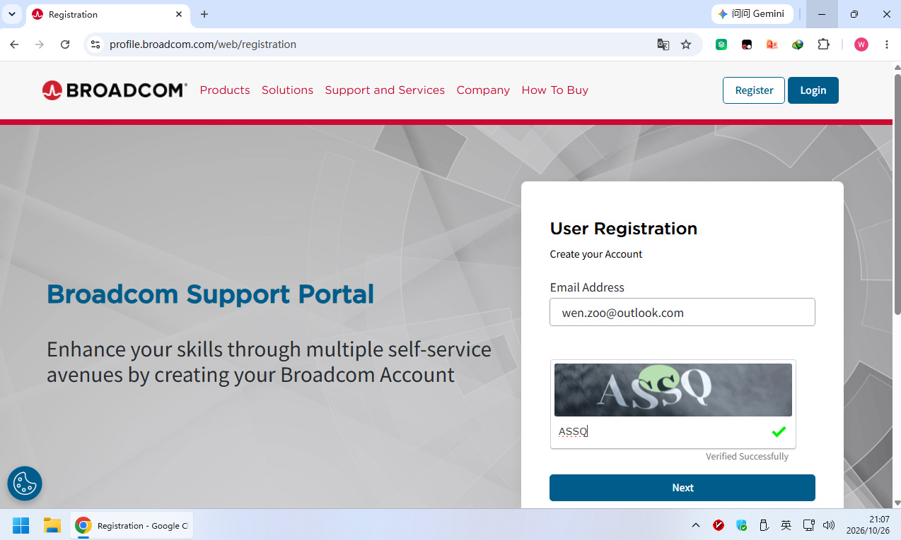

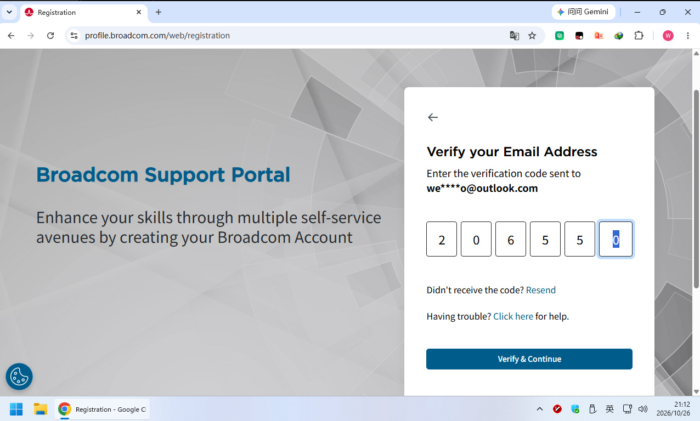

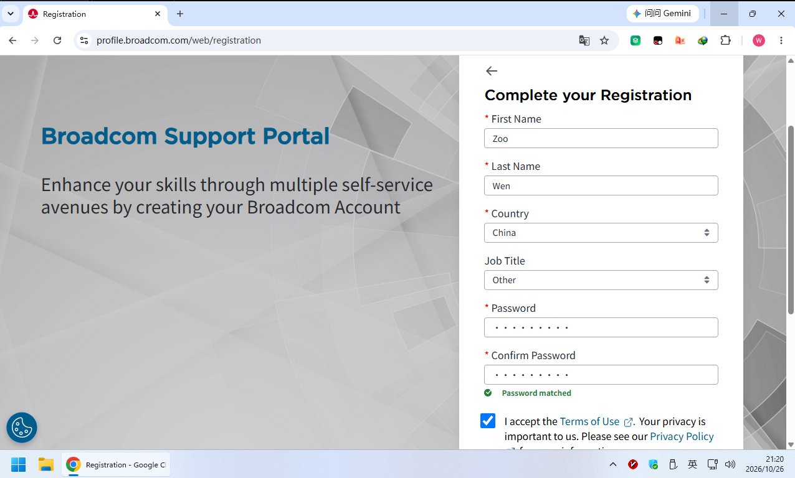

下面是中英文对照

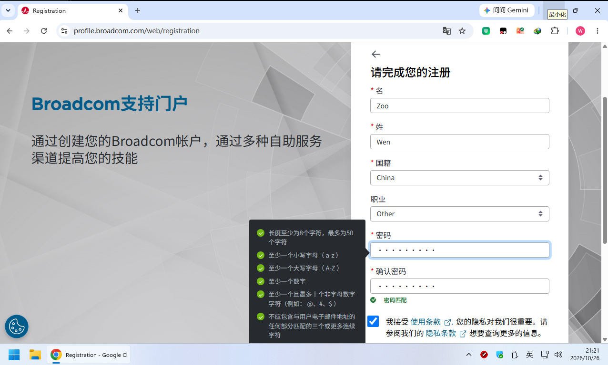

## 第二步：登陆

```
https://support.broadcom.com/
```

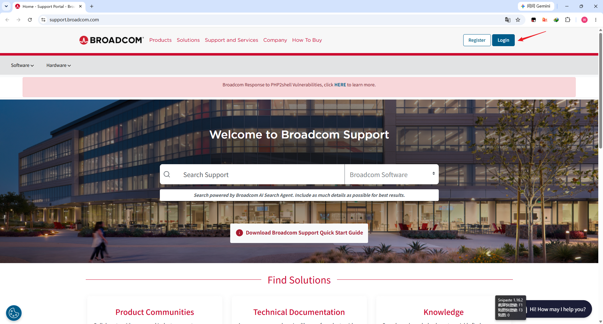

## 第三步：下载

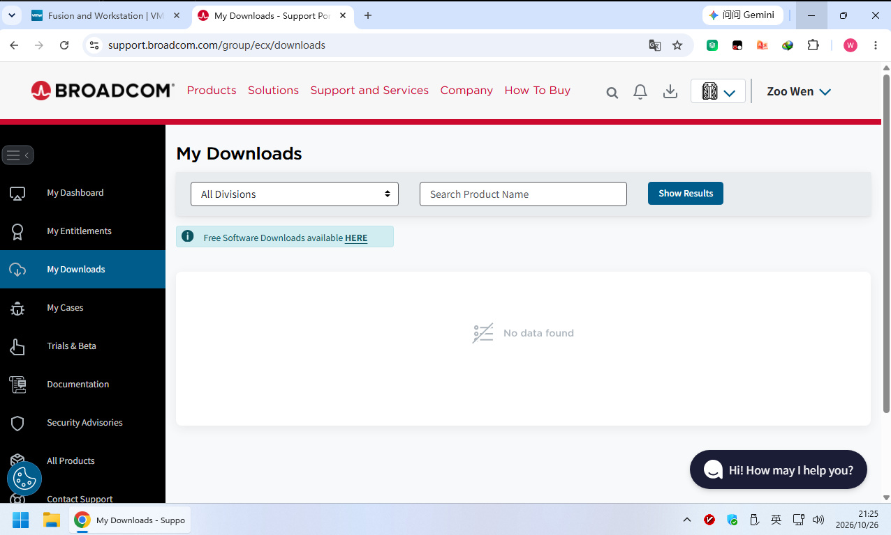

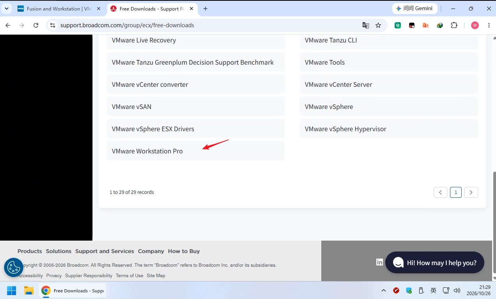

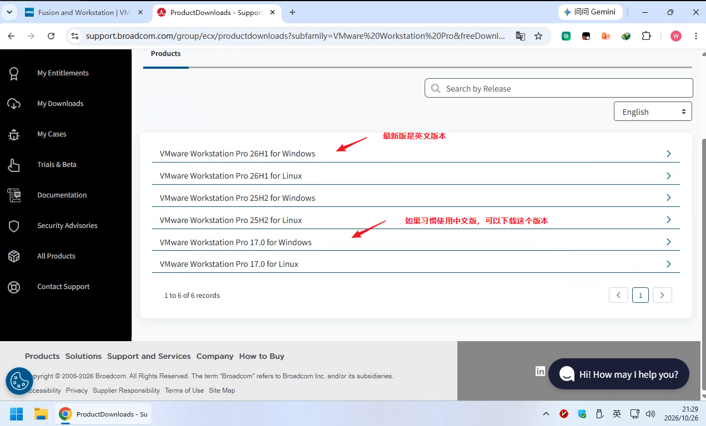

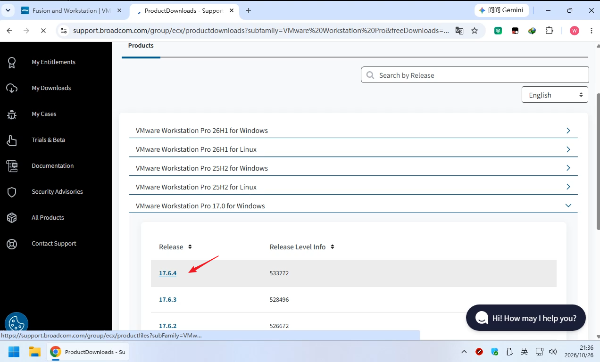

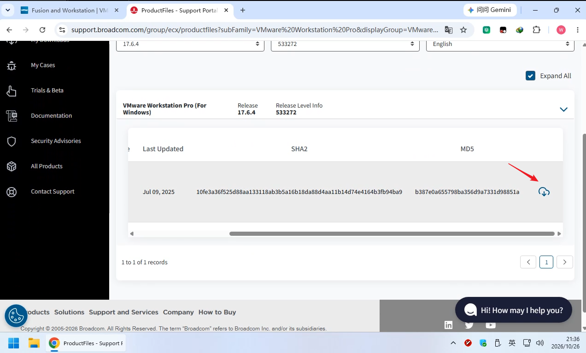

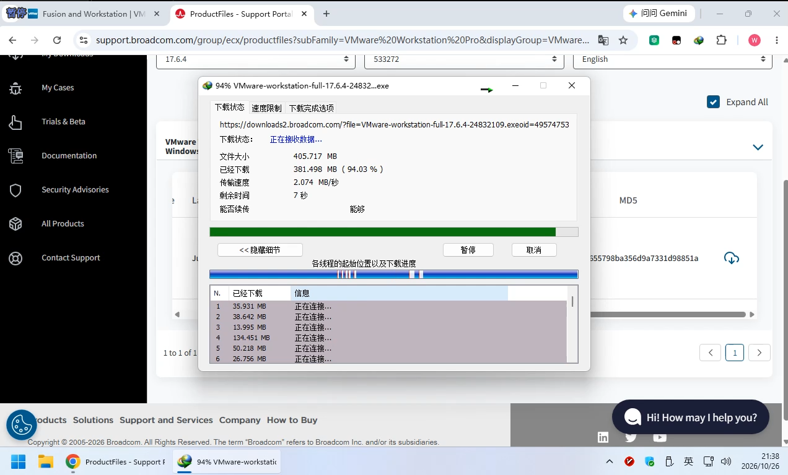

## 第四步：安装

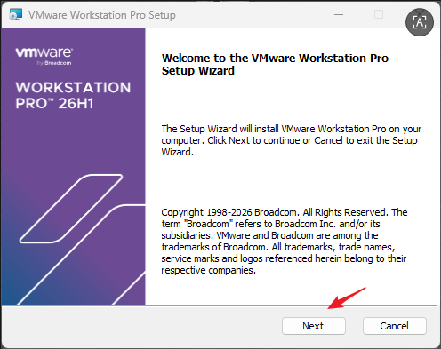

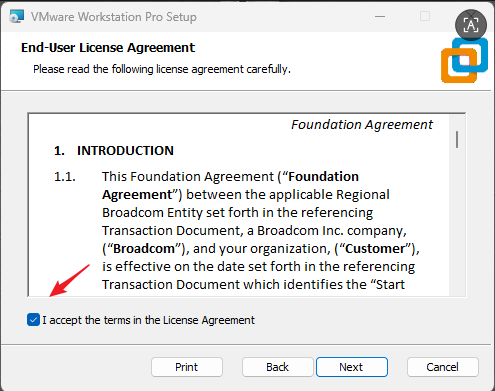

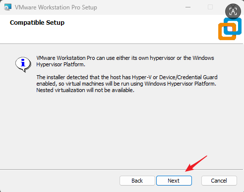

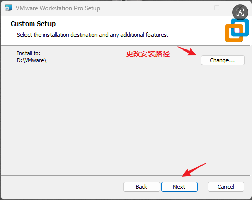

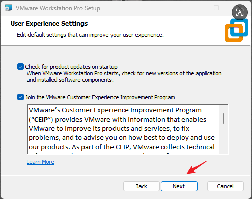

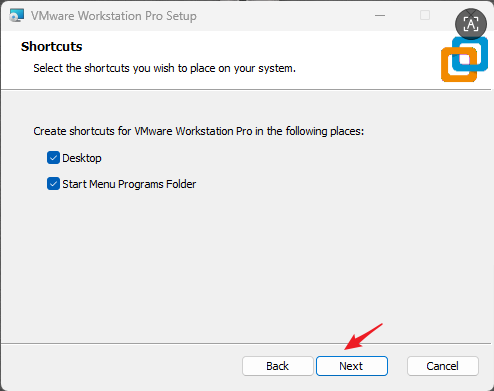

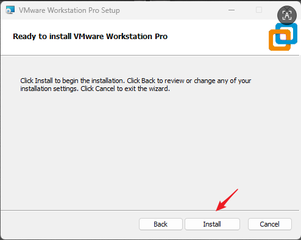

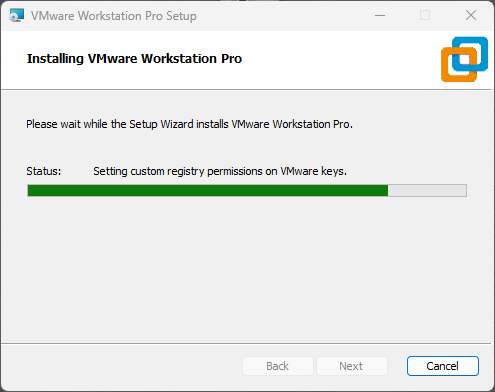

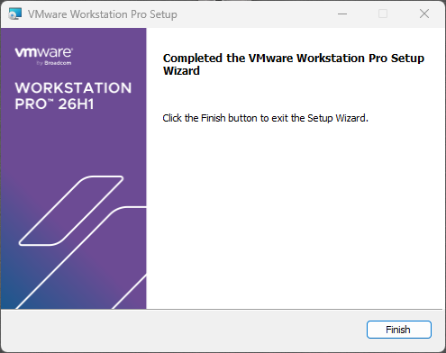

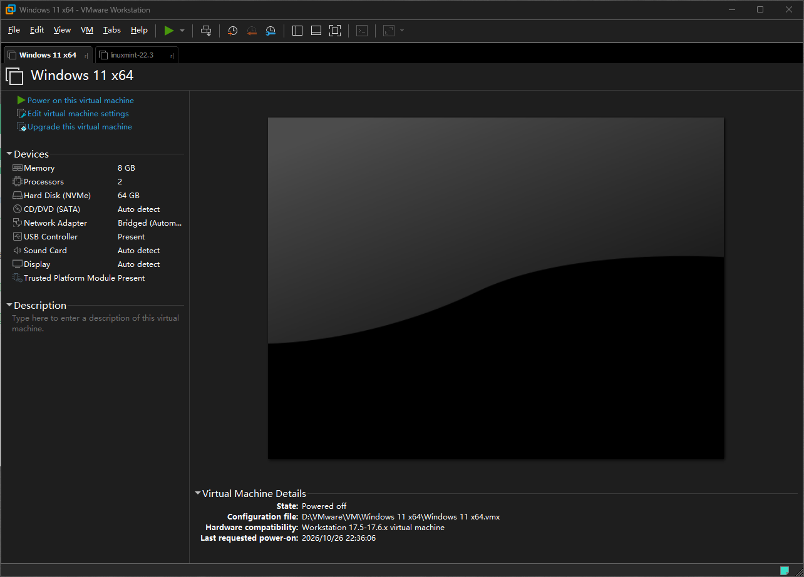
