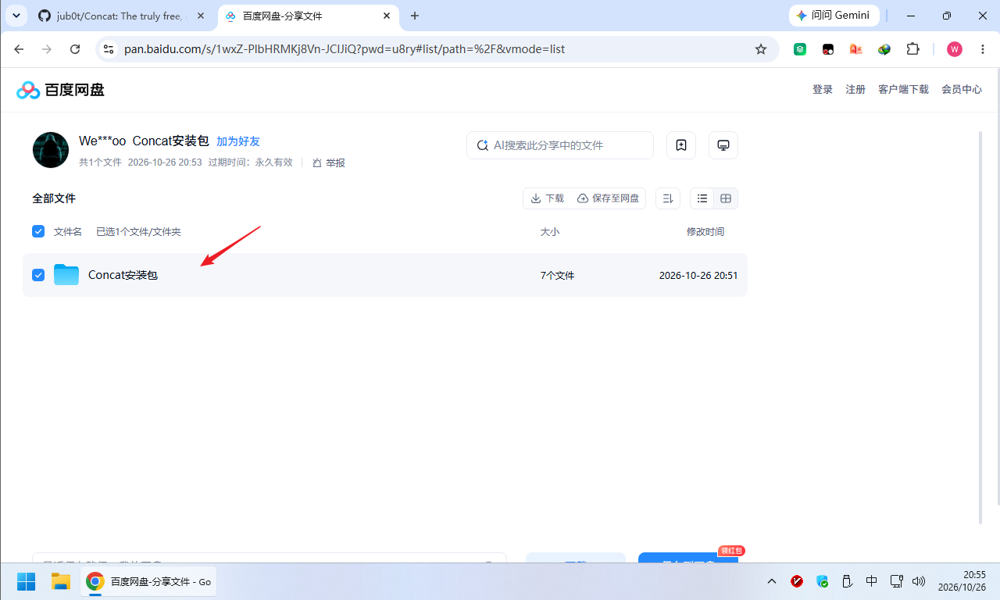
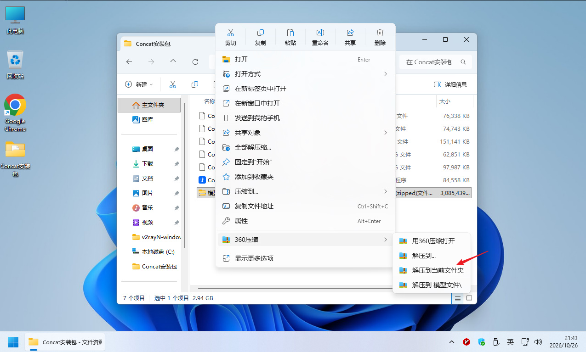
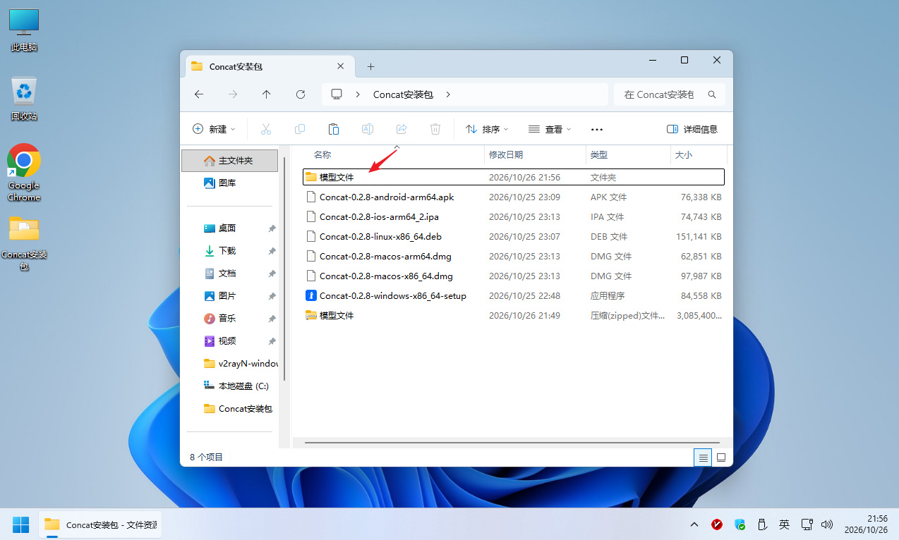
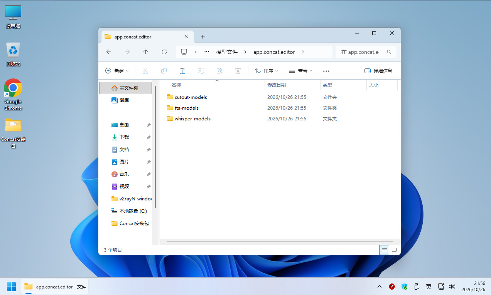
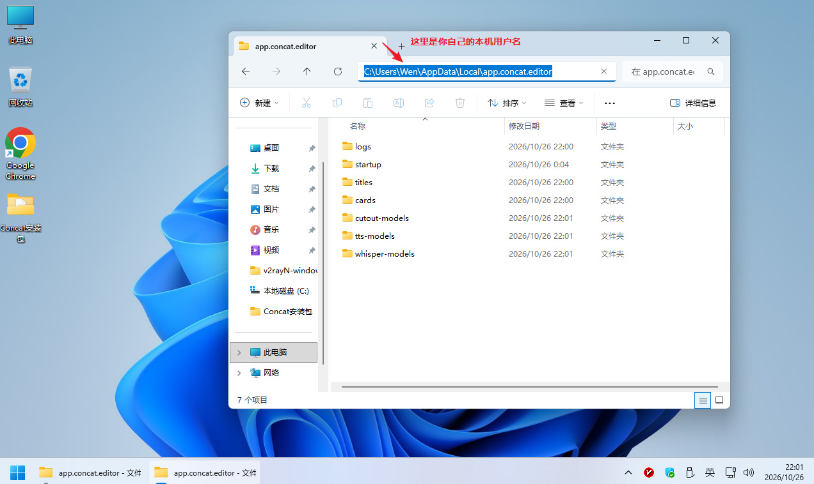
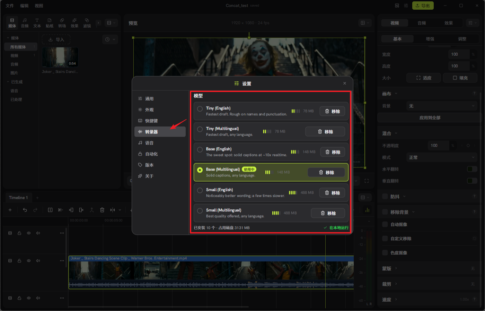
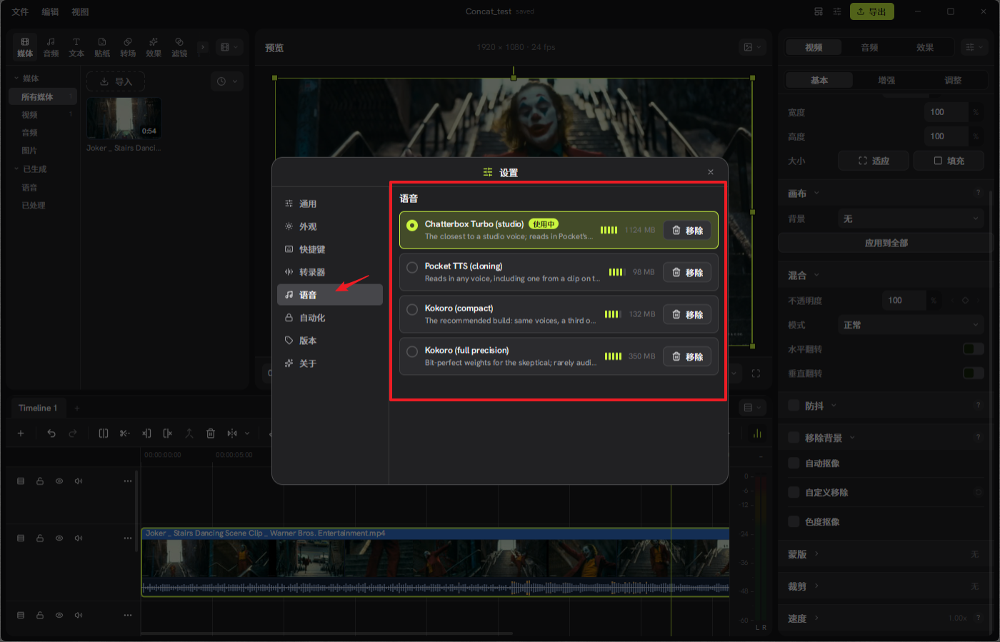

# Concat：一款免费、跨平台、开源的剪影替代品？

Concat 是一款免费、开源的视频编辑器，是 macOS、Windows、Linux 和 Android 上的 CapCut 替代品。它覆盖了人们真正打开 CapCut 要做的事：自动字幕、文字转语音、背景移除、关键帧动画、特效与标题、多轨剪辑、4K 导出。而且没有任何套路：无水印、无需账号、无需订阅、不上传。

一切都在本地运行，基于带 GPU 合成器的原生 Rust 引擎。安装、拖入素材、开剪。字幕、语音和抠像所用的 AI 模型只需在设置中下载一次，之后离线可用。您的素材永远不会离开您的硬盘。

适合： TikTok、Reels 和 Shorts，YouTube 视频，教程与屏幕录制，播客片段，表情包。

也适合机器： 提供 JSON-RPC API，脚本和 AI 代理同样可以用它剪视频。

亮点
🚫 无水印。无账号。无付费墙。 永远如此。
🔒 100 % 本地。 不上传任何内容。离线可用。
💬 自动字幕。 本地 Whisper。选一个模型大小，带样式的字幕就排进时间线。
🗣️ 文字转语音 + 声音克隆。 免费的本地声音，或用几秒钟录音克隆任何声音。
🧍 背景移除。 人物、物体，或者自己涂抹遮罩。
🎞️ 关键帧。 位置、缩放、旋转、不透明度、音量、特效参数。内置曲线编辑器。
✨ 100 种特效、滤镜和转场。 GPU 渲染，预览中实时呈现。
✂️ 快剪。 分割、修剪、涟漪、合并、定格、变速。想要的话还有磁性时间线。
🎚️ 多轨道、多时间线。 一个项目里放多个剪辑版本。混合模式、裁剪、翻转。
📝 标题。 字体、描边、阴影、背景底板。有预设可作起点。
🎙️ 一键人声净化。 降噪、增强人声、响度均衡。还有花栗鼠、机器人、电话等效果。
📤 导出。 H.264、HEVC、AV1。最高 4K 60，10 位色彩。
🦀 原生 Rust 引擎。 GPU 合成器、代理、硬件解码。4K 拖动也顺滑。
🤖 可脚本化。 提供 JSON-RPC API，脚本和 AI 代理可以用它剪视频。从源码构建还会加上 gRPC 和命令行工具。
🖥️ macOS、Windows、Linux、Android。 26 种语言。同一个应用，同样的项目文件。

## 通过网盘分享的文件：Concat安装包

链接: 

```
https://pan.baidu.com/s/1wxZ-PlbHRMKj8Vn-JClJiQ?pwd=u8ry
```

提取码: u8ry


## 模型配置说明：


下载Concat安装包



解压缩，模型文件.zip



打开解压后的文件夹



将app.concat.editor文件夹中的内容复制到



C:\Users\你的用户名\AppData\Local\app.concat.editor 中



重新运行Concat，所有模型都加载了，AI文字转语音，语音转文字，智能抠图，去背景等功能直接可以使用。





注意：AppData 文件夹是系统隐藏文件夹，需要打开显示隐藏文件才能看到，将路径复制到 文件地址栏也可以直接进入对应文件夹。