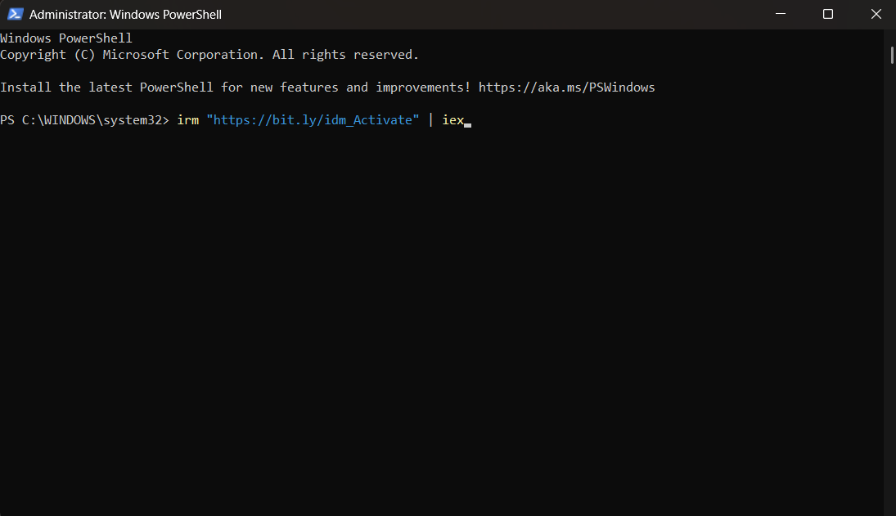
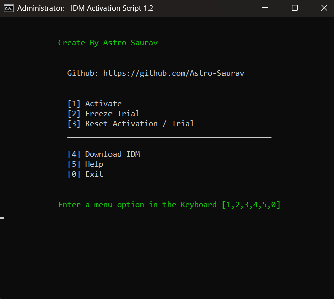

仅供学习研究，切勿用于一切商业用途！
转载自GitHub：当前Star 1.4K，最近更新：2026年9月8日
作者：cyberhavik
项目地址：https://github.com/cyberhavik/IDM-Activation-Script

# IDM激活脚本


一个开源工具，用于激活和重置[Internet Download Manager](https://www.internetdownloadmanager.com/)

# 特点


- 使用注册表项锁定方法冻结IDM试用和激活
- 即使安装IDM更新后，激活和试用仍然存在
- IDM试用重置
- 完全开源
- 基于透明批处理脚本

# 下载/如何使用？⬇️


首先重新安装[Internet Download Manager](https://www.internetdownloadmanager.com/)。确保以前的裂缝/补丁被删除/卸载（如果有）。之后按照以下步骤激活它。

# 方法1-PowerShell


（推荐）

- 右键单击Windows开始菜单并选择PowerShell或终端（非CMD）。

- 复制粘贴以下代码并按回车键

  ```
   irm "https://bit.ly/idm_Activate" | iex
  ```

  

  或者

  ```
   irm "https://raw.githubusercontent.com/cyberhavik/IDM-Activation-Script/main/IAS.ps1" | iex
  ```

  

- 您将看到激活选项，请按照屏幕上的说明进行操作。

- 就这些

# 截图📸






# 信息ℹ️


## 冻结试用🥶


- IDM提供了30天的试用期，您可以在脚本中使用此选项锁定此试用期，这样您就不必再次重置试用期，您的试用期也不会过期。
- 此方法在应用此选项时需要Internet。
- IDM更新可以直接安装，而无需再次冻结它。

## 活化✅


- 此脚本应用注册表锁定方法来激活Internet下载管理器（IDM）。
- 此方法在激活时需要Internet。
- IDM更新可以直接安装，而无需再次激活它。
- 激活后，如果在某些情况下，IDM开始显示激活唠叨屏幕，则只需再次运行激活选项而不使用重置选项。

## 重置IDM激活/试用®️


- Internet下载管理器提供30天的试用期，您可以随时使用此脚本重置此激活/试用期。
- 如果IDM报告假序列号和其他类似错误，此选项也可用于恢复状态。

## 操作系统要求


- Windows7/8/8支持该项目。1/10/11及其服务器等效项。
- Windows 8及更高版本支持运行IAS的PowerShell方法。

## 高级信息


- 要在无人值守模式下激活，请使用 /act参数运行脚本。
- 要在无人参与模式下冻结试用，请使用 /frz参数运行脚本。
- 要在无人值守模式下重置，请使用 /res参数运行脚本。

# 它是如何工作的？


- IDM在不同的注册表项中存储与试用和激活相关的数据。其中一些密钥被锁定以防止它们被篡改，数据以一种模式存储以跟踪假序列问题和剩余的试用天数。要激活它，这里的脚本只需通过在IDM中触发几次下载来生成这些注册表项，识别这些注册表项，并锁定它们，这样IDM就无法编辑和查看它们。这样IDM就无法显示它被假序列号激活的警告。