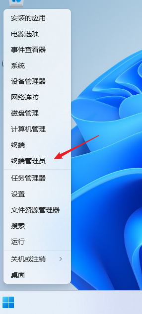
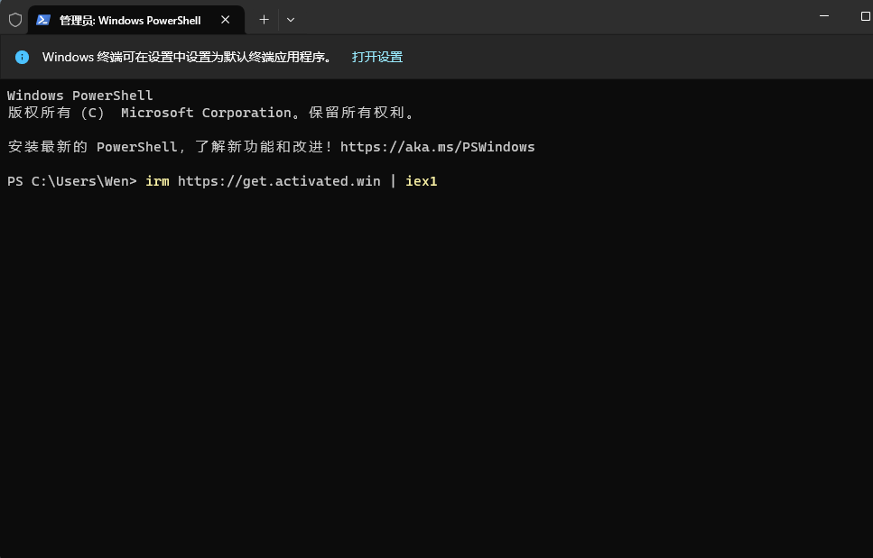
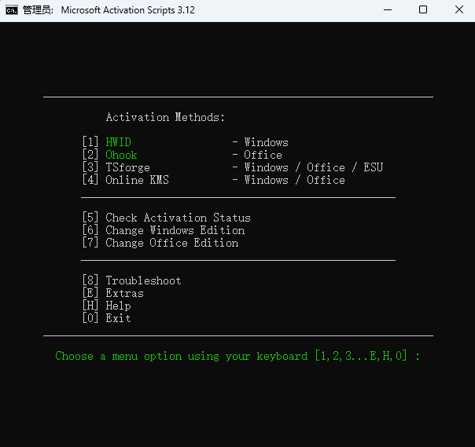

# 一行命令永久激活Win11,Win10，Office, 无需找激活码，无需下载安装。

分享一个开源的 Windows 和 Office 激活脚本，使用很简单，目前已知的最简单方法。不会触发病毒警报。

该激活脚本目前已在 GitHub 上拥有 179K星，安全可靠，无需下载软件，无需去找序列号，直接在控制台输入一条命令即可激活 Windows 10/11，Office。

**联网情况下，以管理员模式启动PowerShell**

在开始按钮上右键，弹出菜单中点击，终端管理员。





1.2. **复制以下命令到Powershell窗口, 回车**

```
irm https://get.activated.win | iex
```



按1（数字许可证激活，HWID方式，永久激活Windows）

**命令详解：**

```
     Activation Methods: 激活方法

 [1] HWID        |  Windows             |   Permanent 永久
 [2] Ohook       |  Office              |   Permanent 永久
 [3] TSforge     |  Windows/Office/ESU  |   Permanent 永久, 2025年2月19日新增，最新的3.0版才有
 [4] KMS38       |  Windows             |   Year 2038 到2038年
 [5] Online KMS  |  Windows / Office    |   180 Days 180天
 __________________________________________________

 [6] Check Activation Status 检查激活状态
 [7] Change Windows Edition 改Windows版本
 [8] Change Office Edition 改Office版本
 __________________________________________________

 [9] Troubleshoot 疑难排解
 [E] Extras 附加选项
 [H] Help 帮助
 [0] Exit 退出
 ______________________________________________________

      用键盘输入选择项，方括号中为可选项 [1,2,3,4,5,6,7,8,9,E,H,0] :
```

