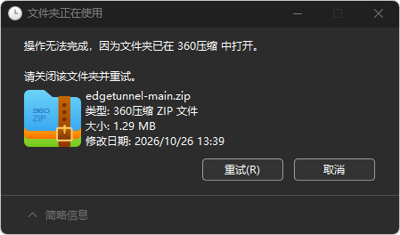

# 文件正在使用无法删除解决方法

有时候在Windows系统中删除文件会出现，“文件正在使用，无法删除。”或“文件夹正在使用，无法删除。”

如图：

找出究竟是谁占用了文件
如果你想知道到底是哪个程序锁定了这个 ZIP 文件，可以使用 Windows 自带的资源监视器。
1. 按 Win + R。
2. 输入：
resmon

3. 回车，打开“资源监视器”。
4. 切换到“CPU”选项卡。
5. 找到右侧的“关联的句柄”。
6. 在搜索框中输入：
edgetunnel-main.zip
7. 在搜索结果上右键结束进程。
8. 再次删除文件就删掉了。